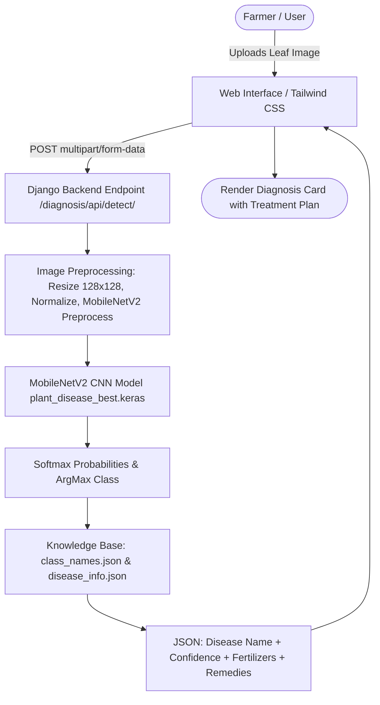

# 🌱 Kisan Chikitsa (किसान चिकित्सा)

[](https://www.python.org/)
[](https://www.djangoproject.com/)
[](https://www.tensorflow.org/)
[](https://keras.io/)
[](https://tailwindcss.com/)
[](LICENSE)

> **Kisan Chikitsa** (*FloraFix*) is an AI-powered agricultural diagnosis and advisory platform designed to help farmers, agronomists, and home growers detect plant diseases in real time from leaf imagery. Powered by deep learning (MobileNetV2 CNN) and a full-stack Django framework, the platform provides instant diagnosis, confidence ratings, actionable remedy instructions, and crop-specific fertilizer recommendations.

---

## 📌 Table of Contents

- [Overview](#-overview)
- [Key Features](#-key-features)
- [System Architecture & Workflow](#-system-architecture--workflow)
- [Supported Crops & Diseases](#-supported-crops--diseases)
- [Tech Stack](#-tech-stack)
- [Directory Structure](#-directory-structure)
- [Getting Started](#-getting-started)
  - [Prerequisites](#prerequisites)
  - [Installation Steps](#installation-steps)
  - [Running the Application](#running-the-application)
- [API Reference](#-api-reference)
- [Disease & Fertilizer Knowledge Base](#-disease--fertilizer-knowledge-base)
- [Upcoming Roadmap](#-upcoming-roadmap)
- [Contributing](#-contributing)
- [License](#-license)

---

## 🔍 Overview

Crop diseases cause substantial yield loss worldwide, impacting food security and farmer livelihoods. **Kisan Chikitsa** bridges the gap between complex machine learning and everyday agricultural practice:

1. **Instant Leaf Scanning**: Users upload leaf photos directly from their smartphone or computer.
2. **Deep Learning Inference**: A lightweight, high-performance Convolutional Neural Network (CNN) based on MobileNetV2 evaluates the leaf patterns.
3. **Prescriptive Guidance**: Rather than just naming the disease, the platform provides actionable treatment steps, biological controls, and chemical/fertilizer advisories tailored to the detected pathogen.

---

## ✨ Key Features

- 🌿 **38-Class Plant Disease Identification**: Detects 38 conditions (both healthy states and pathogenic infections) across 14 vital crop families.
- ⚡ **Real-Time Deep Learning Inference**: High-accuracy predictions with instant confidence scores using Keras and MobileNetV2 feature extraction.
- 🩺 **Automated Remedy & Treatment Advisory**: Curated remedial steps—including cultural practices (pruning, airflow, crop rotation) and safe fungicide/bactericide applications.
- 🧪 **Precision Fertilizer Recommender**: Specific fertilizer formulations (NPK blends, Urea, DAP, MOP, Dolomitic Lime, micronutrients) to replenish stressed plants.
- 💻 **Modern, Responsive Web Portal**:
  - Clean glassmorphism styling and dark-theme aesthetic powered by Tailwind CSS.
  - Live client-side image preview before submission.
  - Async AJAX request handling without page reloading.
- 🔐 **User Authentication System**: Built-in account registration, login, session management, and custom user profile handling.
- 🔌 **Extensible REST API**: Dedicated endpoint (`/diagnosis/api/detect/`) allowing mobile apps, IoT devices, or third-party farm management tools to run diagnostics remotely.

---

## 🏗 System Architecture & Workflow



---

## 🌾 Supported Crops & Diseases

The underlying model covers **38 distinct classes** spanning **14 crop types**:

| Crop | Detectable Conditions & Diseases |
| :--- | :--- |
| **Apple** | Apple Scab, Black Rot, Cedar Apple Rust, Healthy |
| **Blueberry** | Healthy |
| **Cherry (incl. Sour)** | Powdery Mildew, Healthy |
| **Corn (Maize)** | Cercospora Leaf Spot (Gray Leaf Spot), Common Rust, Northern Leaf Blight, Healthy |
| **Grape** | Black Rot, Esca (Black Measles), Leaf Blight (Isariopsis Leaf Spot), Healthy |
| **Orange** | Huanglongbing (Citrus Greening) |
| **Peach** | Bacterial Spot, Healthy |
| **Bell Pepper** | Bacterial Spot, Healthy |
| **Potato** | Early Blight, Late Blight, Healthy |
| **Raspberry** | Healthy |
| **Soybean** | Healthy |
| **Squash** | Powdery Mildew |
| **Strawberry** | Leaf Scorch, Healthy |
| **Tomato** | Bacterial Spot, Early Blight, Late Blight, Leaf Mold, Septoria Leaf Spot, Spider Mites (Two-Spotted Spider Mite), Target Spot, Yellow Leaf Curl Virus, Mosaic Virus, Healthy |

---

## 🛠 Tech Stack

### **Backend & Framework**
- **[Python](https://www.python.org/)** (v3.10+)
- **[Django](https://www.djangoproject.com/)** (v5.0+) – MVC Web Framework, ORM, URL Routing, Authentication
- **[SQLite](https://www.sqlite.org/)** – Lightweight relational database for users & profiles

### **Machine Learning & Computer Vision**
- **[TensorFlow](https://www.tensorflow.org/) & [Keras](https://keras.io/)** – Model inference and weights pipeline
- **[MobileNetV2](https://arxiv.org/abs/1801.04381)** – Deep Convolutional Neural Network architecture
- **[NumPy](https://numpy.org/)** – Numerical array manipulation
- **[Pillow (PIL)](https://python-pillow.org/)** – Image processing & resizing

### **Frontend & UI**
- **[Tailwind CSS](https://tailwindcss.com/)** – Modern utility-first styling with Glassmorphism UI
- **Vanilla JavaScript (ES6+)** – Asynchronous fetch API and DOM manipulation
- **Google Fonts** – *Orbitron*, *Exo 2*, *Poppins*, *Merriweather*

---

## 📁 Directory Structure

```text
kisan-chikitsa/
├── backend/
│   ├── accounts/                   # User authentication & profile management
│   │   ├── migrations/             # Database migrations
│   │   ├── templates/              # Auth & landing templates (index, signin, signup)
│   │   ├── models.py               # Profile & user models
│   │   ├── views.py                # Registration and login views
│   │   └── urls.py                 # Account routing
│   │
│   ├── diagnosis/                  # Core plant disease detection application
│   │   ├── templates/              # Diagnosis dashboard (diagnose.html)
│   │   ├── predictor.py            # Model loading, image preprocessing, and inference
│   │   ├── views.py                # View handlers
│   │   ├── urls.py                 # Diagnosis & API endpoints
│   │   └── tests.py                # Unit and inference tests
│   │
│   ├── kisan_chikitsa/             # Django project configuration
│   │   ├── settings.py             # Settings and configuration
│   │   ├── urls.py                 # Root URL configuration
│   │   └── wsgi.py                 # WSGI application entry
│   │
│   ├── ml_models/                  # Machine learning assets
│   │   ├── plant_disease_best.keras # Trained MobileNetV2 model weights
│   │   ├── class_names.json        # Class label indices to disease mapping
│   │   └── disease_info.json       # Remedies & fertilizer recommendations mapping
│   │
│   ├── static/                     # CSS, JS, and client-side assets
│   │   ├── diagnose_script.js      # Diagnosis async upload script
│   │   └── diagnose_style.css      # Custom styling & animations
│   │
│   ├── test_images/                # Sample leaf images for verification
│   │   └── sample_leaf.jpeg
│   │
│   ├── media/                      # Uploaded media staging directory
│   ├── manage.py                   # Django management script
│   └── db.sqlite3                  # Local database
│
├── .gitignore                      # Git ignore file
├── requirements.txt                # Python package dependencies
└── README.md                       # Project documentation
```

---

## 🚀 Getting Started

### Prerequisites

- **Python** (version 3.10 or 3.11 recommended)
- **pip** (Python package manager)
- **Git**

### Installation Steps

1. **Clone the repository:**
   ```bash
   git clone https://github.com/Anubhab8988/Kishan-Chikitsha.git
   cd Kishan-Chikitsha/kisan-chikitsa
   ```

2. **Create and activate a virtual environment:**
   - **On Windows:**
     ```bash
     python -m venv venv
     venv\Scripts\activate
     ```
   - **On macOS / Linux:**
     ```bash
     python3 -m venv venv
     source venv/bin/activate
     ```

3. **Install dependencies:**
   ```bash
   pip install -r requirements.txt
   ```
   *(Or navigate into `backend/` and install: `pip install django tensorflow keras numpy pillow django-extensions`)*

4. **Apply database migrations:**
   ```bash
   cd backend
   python manage.py makemigrations
   python manage.py migrate
   ```

5. **Create a superuser (Optional, for admin panel):**
   ```bash
   python manage.py createsuperuser
   ```

### Running the Application

1. **Start the Django development server:**
   ```bash
   python manage.py runserver
   ```

2. **Open in your browser:**
   - **Landing Page:** [http://127.0.0.1:8000/](http://127.0.0.1:8000/)
   - **Diagnosis Portal:** [http://127.0.0.1:8000/diagnosis/](http://127.0.0.1:8000/diagnosis/)
   - **Sign In / Registration:** [http://127.0.0.1:8000/signin/](http://127.0.0.1:8000/signin/)
   - **Django Admin:** [http://127.0.0.1:8000/admin/](http://127.0.0.1:8000/admin/)

---

## 📡 API Reference

Kisan Chikitsa exposes a direct REST endpoint for leaf disease diagnosis.

### **Detect Plant Disease**

```http
POST /diagnosis/api/detect/
```

#### **Request Parameters**
- **Content-Type**: `multipart/form-data`
- **Body**:
  | Field | Type | Required | Description |
  | :--- | :--- | :--- | :--- |
  | `image` | `File (Binary)` | **Yes** | Image of the plant leaf (`.jpg`, `.jpeg`, `.png`) |
  | `model` | `String` | No | Model choice (default: `"best"`) |

#### **Example cURL Request**
```bash
curl -X POST http://127.0.0.1:8000/diagnosis/api/detect/ \
  -F "image=@/path/to/leaf_image.jpg" \
  -F "model=best"
```

#### **Sample JSON Response**
```json
{
  "disease": "Tomato___Early_blight",
  "confidence": "96.45%",
  "fertilizers": [
    "Urea",
    "Diammonium Phosphate",
    "Sulphate of Potash/ Muriate of Potash"
  ],
  "remedies": [
    "Remove infected leaves",
    "Apply preventive fungicides like Mancozeb",
    "Maintain good spacing"
  ]
}
```

---

## 💊 Disease & Fertilizer Knowledge Base

The platform links each detected condition to scientifically backed agronomic management practices stored in [`disease_info.json`](backend/ml_models/disease_info.json):
- **Cultural Controls**: Crop rotation schedules, pruning guidelines, droplet and moisture control, sanitation of tools.
- **Organic & Chemical Interventions**: Mancozeb, Captan, Copper-based bactericides, Sulfur sprays, or biological controls (e.g. miticides).
- **Nutrient Recovery**: Balanced NPK, Gypsum, Calcium Nitrate, and Zinc Sulfate replenishments tailored to diseased stress conditions.

---

## 🗺 Upcoming Roadmap

- [ ] **Multilingual Support**: Hindi, Bengali, Tamil, Telugu, and other regional Indian languages for rural accessibility.
- [ ] **AI Agronomist Chatbot**: Conversational assistant powered by LLMs for farmer queries and weather-based crop advice.
- [ ] **Government Scheme Finder**: Real-time integration of Indian agricultural schemes (PM-KISAN, PMFBY, Soil Health Card).
- [ ] **Offline Edge Inference**: Mobile application (Flutter/React Native) using TensorFlow Lite for inference in low-connectivity areas.
- [ ] **Community Forum**: Peer-to-peer discussion and expert verification board for unusual disease outbreaks.

---

## 🤝 Contributing

Contributions make the open-source community an amazing place to learn, inspire, and create! Any contributions are **greatly appreciated**.

1. Fork the Project
2. Create your Feature Branch (`git checkout -b feature/AmazingFeature`)
3. Commit your Changes (`git commit -m 'Add some AmazingFeature'`)
4. Push to the Branch (`git push origin feature/AmazingFeature`)
5. Open a Pull Request

---

## 📄 License

Distributed under the **MIT License**. See `LICENSE` for more information.

---

## 👨‍💻 Author & Acknowledgements

- **Author**: Anubhab ([@Anubhab8988](https://github.com/Anubhab8988))
- **Dataset**: [PlantVillage Dataset](https://github.com/spMohanty/PlantVillage-Dataset)
- **Deep Learning Architecture**: [MobileNetV2 by Google Research](https://arxiv.org/abs/1801.04381)

<p align="center">
  Made with ❤️ for the farming community 🌱
</p>

